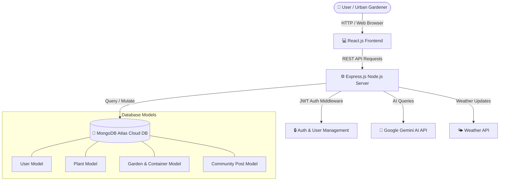

<div align="center">

# 🌿 HariVriksh (हरिवृक्ष)
### *Smart Urban & Terrace Gardening Platform*

[](https://mongodb.com)
[](https://reactjs.org)
[](https://nodejs.org)
[](https://mongodb.com)
[](https://deepmind.google/technologies/gemini/)

<br/>

<p align="center">
  <a href="http://localhost:3000" target="_blank">
    
  </a>
  &nbsp;&nbsp;
  <a href="http://localhost:5000/api/health" target="_blank">
    
  </a>
</p>

<p align="center">
  <b>Transforming Urban Spaces into Thriving Green Sanctuaries</b><br/>
  An intelligent, end-to-end platform tailored for terrace gardens, container matching, organic soil mix recipes, and AI-powered plant health diagnosis.
</p>

[🚀 Launch Live App](http://localhost:3000) • [Explore Features](#-key-features) • [Plant Catalog](#-plant-catalog--dataset) • [Tech Stack](#-technology-stack) • [Quick Start](#-getting-started) • [API Guide](#-api-endpoints)

---

</div>

## 📖 Overview

**HariVriksh** is a full-stack MERN web application built specifically for urban households, apartment residents, and terrace gardening enthusiasts. Designed around real-world space constraints, climate conditions, and container availability in Indian homes, HariVriksh bridges the gap between city living and sustainable green practices.

Whether you want to repurpose paint buckets for tomatoes, turn plastic bottles into windowsill mint gardens, or diagnose yellow leaves using AI, HariVriksh provides a complete digital assistant for every stage of plant growth.

---

## ✨ Key Features

### 🪴 1. Smart Container Matchmaker Engine
- Calculates root depth, soil volume, and drainage requirements.
- Matches specific plants to repurposed household containers:
  - 🍾 **Bottles (500ml–2L):** Ideal for Herbs & Microgreens.
  - 🪣 **Buckets (5L–20L):** Excellent for Tomatoes, Brinjal & Okra.
  - 🛍️ **Grow Bags (3L–50L):** High-aeration fabric bags for root crops & bushes.
  - 🔧 **PVC Pipes:** Vertical wall gardens for space-saving spinach and lettuce.
  - 📦 **Shallow Trays:** Perfect for cut-and-come-again microgreens.

### 🌿 2. Curated 38+ Plant Knowledge Base
- Complete growing guides for **38 unique, non-duplicated plant varieties**.
- Category breakdown across Herbs, Vegetables, Leafy Greens, Flowers, and Fruit Trees.
- Includes scientific names, germination steps, harvest timelines, ideal temperatures, sunlight requirements, and common pest fixes.

### 🧪 3. Custom Soil Mix & Fertilizer Schedules
- Tailored soil blend recipes (Cocopeat, Vermicompost, Garden Soil, River Sand, Perlite).
- Step-by-step organic fertilization timelines (NPK, Liquid Compost Tea, DAP, Wood Ash, Bone Meal).

### 🤖 4. Integrated AI Plant Doctor (Google Gemini AI)
- AI assistant providing real-time disease diagnosis, pest solutions (e.g., natural neem oil treatments), and expert gardening advice.

### 📅 5. Personal Garden Manager & Care Reminders
- Add plants to your personal digital terrace garden (`My Garden`).
- Set custom watering schedules and harvest alerts with real-time notifications.

### 💬 6. Community Hub & Social Feed
- Interactive community section to share garden progress, post photos, exchange organic tips, and celebrate harvests with fellow growers.

---

## 📊 Plant Catalog & Dataset

HariVriksh features a database of **38 clean, unique plant entries** categorized for container farming:

| Category | Icon | Varieties Included | Ideal Containers |
| :--- | :---: | :--- | :--- |
| **Herbs** | 🌿 | Mint (Pudina), Coriander (Dhaniya), Basil (Tulsi), Curry Leaf (Kadi Patta), Aloe Vera, Ginger (Adrak), Turmeric (Haldi), Ashwagandha | Bottle, Tray, Pot, Grow Bag |
| **Vegetables** | 🍅 | Tomato, Chilli (Mirchi), Capsicum, Brinjal (Baingan), Okra (Bhindi), Bottle Gourd (Lauki), Bitter Gourd (Karela), Pumpkin (Kaddu), Radish (Mooli), Moringa (Drumstick) | Bucket, Grow Bag, Trellis Pot |
| **Leafy Greens** | 🥬 | Spinach (Palak), Fenugreek (Methi), Lettuce, Kale, Red Amaranth (Lal Saag) | Shallow Tray, PVC Pipe, Bottle |
| **Flowers** | 🌺 | Marigold, Rose, Sunflower, Jasmine (Mogra), Hibiscus (Gudhal), Lavender, Portulaca, Bougainvillea | Pot, Grow Bag, Railing Basket |
| **Fruits** | 🍋 | Lemon (Nimbu), Mango (Aam), Guava (Amrood), Papaya (Papita), Strawberry, Pomegranate (Anar), Banana (Kela) | Large Container (20L–50L) |

---

## 🏗️ Architecture & System Design



---

## 🛠️ Technology Stack

| Layer | Technology | Usage |
| :--- | :--- | :--- |
| **Frontend** | React 18, React Router v6, Axios | Responsive Single Page Application (SPA) |
| **Styling** | Modern Vanilla CSS, Glassmorphism, Responsive Grid | Custom UI Design System with dark accents |
| **Backend** | Node.js, Express.js | RESTful API server architecture |
| **Database** | MongoDB Atlas, Mongoose ODM | Cloud document storage & schema mapping |
| **Security** | JSON Web Tokens (JWT), bcryptjs | Secure user authentication & sessions |
| **AI Integration** | `@google/generative-ai` (Gemini API) | Automated plant doctor & intelligent assistant |
| **File Uploads** | Multer | Local static image upload management |

---

## 📁 Repository Structure

```
harivriksh/
├── backend/
│   ├── data/
│   │   └── clean_plants.json      # Master plant dataset (38 unique entries)
│   ├── middleware/
│   │   └── auth.js                 # JWT authorization middleware
│   ├── models/
│   │   ├── Plant.js                # Plant schema & indexes
│   │   ├── Garden.js               # Garden & Container schemas
│   │   ├── Post.js                 # Community feed schema
│   │   └── User.js                 # User authentication schema
│   ├── routes/
│   │   ├── plants.js               # Plant catalog REST endpoints
│   │   ├── gardens.js              # Personal garden endpoints
│   │   ├── ai.js                   # Gemini AI assistant route
│   │   └── auth.js                 # Login & Registration routes
│   ├── seedData.js                 # Auto-seeding logic
│   ├── reseed.js                   # Instant DB reset script
│   ├── server.js                   # Express application entrypoint
│   └── .env.example                # Environment variable configuration template
├── frontend/
│   ├── public/                     # Static HTML template & icons
│   ├── src/
│   │   ├── components/             # Reusable UI components (Navbar, Footer, PlantCard)
│   │   ├── context/                # AuthContext & global state
│   │   ├── pages/                  # Application views (Plants, Dashboard, Community, AI)
│   │   ├── utils/                  # API client instance & helpers
│   │   ├── App.js                  # Main router setup
│   │   └── index.css               # Global CSS design tokens
│   └── package.json
├── README.md                       # Project documentation
└── .gitignore                      # Safe ignore list (excludes node_modules & .env)
```

---

## 🚀 Getting Started

### Prerequisites
- **Node.js** (v16.0 or higher)
- **npm** (v8.0 or higher)
- **MongoDB Atlas Connection URI**

### 1. Clone the Repository
```bash
git clone https://github.com/Aryajais911/HariVriksh.git
cd HariVriksh/harivriksh
```

### 2. Configure Environment Variables
Create a `.env` file inside `harivriksh/backend/`:

```env
PORT=5000
MONGODB_URI=mongodb+srv://<username>:<password>@cluster0.mongodb.net/Harivriksh?appName=Cluster0&ssl=true&tls=true
JWT_SECRET=your_super_secret_jwt_key
JWT_EXPIRE=7d
NODE_ENV=development
GEMINI_API_KEY=your_google_gemini_api_key
CLIENT_URL=http://localhost:3000
```

### 3. Install Dependencies & Run
From the root `harivriksh/` folder, run:

```bash
# Install all root, backend, and frontend dependencies
npm run install-all

# Start both Backend (Port 5000) and Frontend (Port 3000) concurrently
npm run dev
```

Visit **`http://localhost:3000`** in your browser to launch HariVriksh!

---

## 📡 API Endpoints Summary

| Method | Endpoint | Description | Auth Required |
| :--- | :--- | :--- | :---: |
| `GET` | `/api/health` | API Health Check & Status | ❌ |
| `GET` | `/api/plants` | Fetch all 38+ plant varieties | ❌ |
| `GET` | `/api/plants/:id` | Get detailed plant specs & growing steps | ❌ |
| `POST` | `/api/auth/register` | Register new urban gardener account | ❌ |
| `POST` | `/api/auth/login` | Authenticate user & return JWT | ❌ |
| `GET` | `/api/gardens/my-garden` | Fetch user's active garden containers | ✅ |
| `POST` | `/api/gardens/add` | Add plant to personal terrace garden | ✅ |
| `POST` | `/api/ai/chat` | Send prompt to Gemini AI Gardening Doctor | ✅ |
| `GET` | `/api/posts` | Fetch community garden feed | ❌ |

---

## 🤝 Contributing

Contributions make the open-source community an amazing place to learn, inspire, and create. Any contributions to HariVriksh are **greatly appreciated**!

1. Fork the Project
2. Create your Feature Branch (`git checkout -b feature/AmazingFeature`)
3. Commit your Changes (`git commit -m 'Add some AmazingFeature'`)
4. Push to the Branch (`git push origin feature/AmazingFeature`)
5. Open a Pull Request

---

<div align="center">

Made with ❤️ for Green Roofs & Sustainable Homes 🌿  
**HariVriksh Team**

</div>
